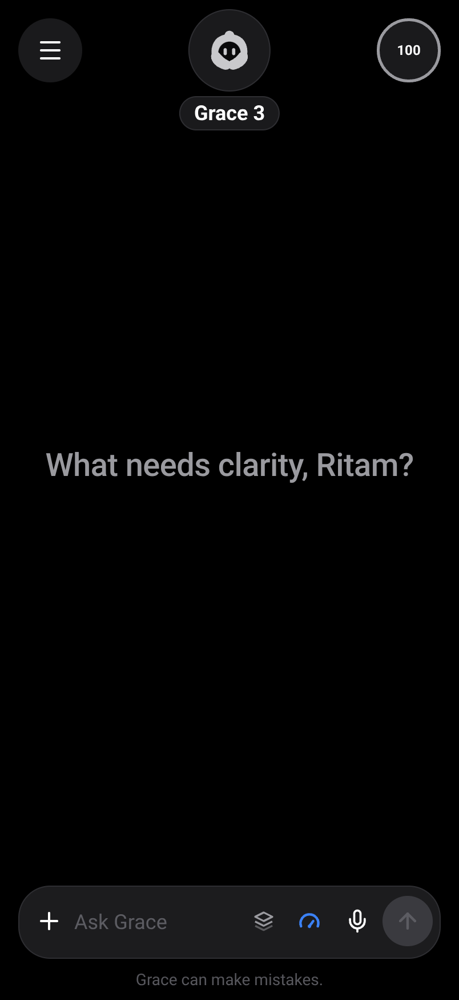
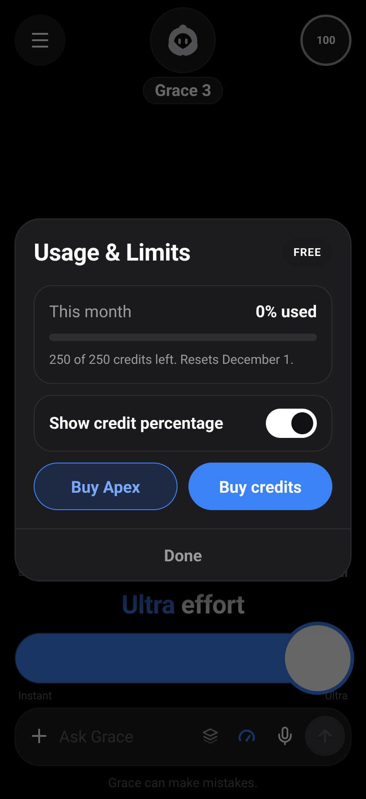
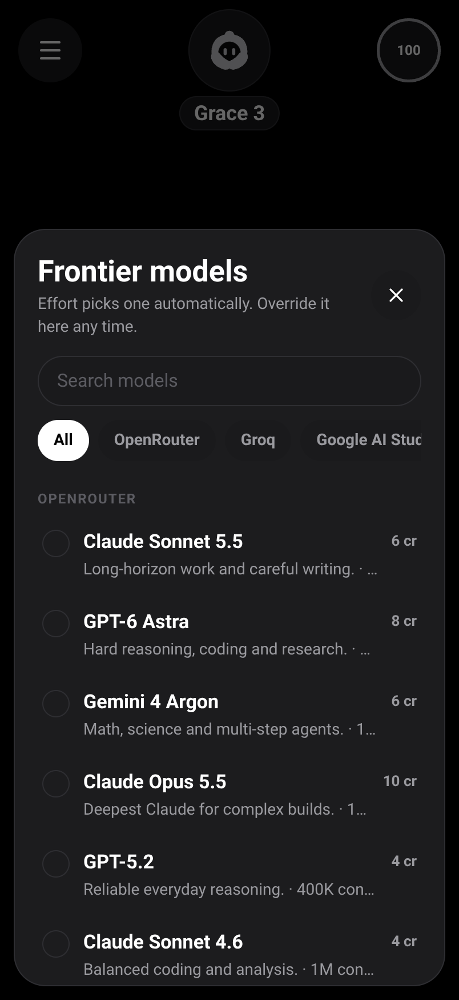
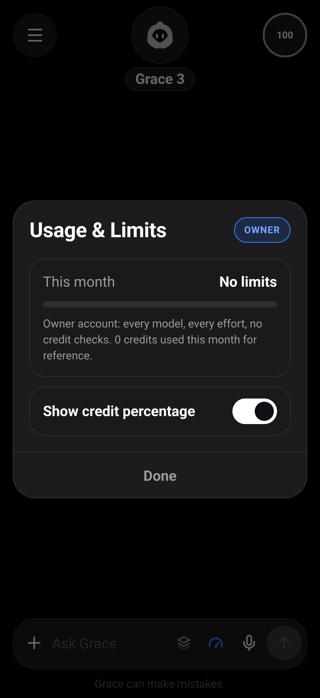

# Grace AI

A quiet, fast AI chat workspace. One input, five effort levels, and every
frontier model behind a single router — OpenRouter, Groq, Google AI Studio and
NVIDIA NIM.

The interface follows [`DESIGN.md`](./DESIGN.md) exactly: flat black, one accent
blue, fully rounded controls, and more than 48px touch targets everywhere.



## What works today

| Area | Status |
| --- | --- |
| Chat with streaming answers | ✅ NDJSON stream, stop button, regenerate, copy |
| Effort routing (Instant → Ultra) | ✅ five levels, temperature + reasoning hints, model tier mapping |
| Frontier model picker | ✅ 26 models across OpenRouter, Groq, Google AI Studio and NVIDIA, per-chat override |
| Grace Code | ✅ a real file workspace with a multi-file agent, plus GitHub import and push |
| Provider connection | ✅ server-side keys (env or admin console), write-only from the browser |
| Accounts | ✅ email + password, scrypt hashes, httpOnly session cookies |
| Credits | ✅ per-turn cost by model and effort, monthly allowance, credits ring |
| Attachments | ✅ up to 6 files, PDF text extraction, images to vision models |
| Conversation history | ✅ list, open, rename with the first prompt, delete |
| Usage & Limits modal | ✅ matches DESIGN.md §6.6, including the percentage toggle |
| Admin console | ✅ owner-only key management and routing table |
| Supabase storage | ✅ REST or direct Postgres; JSON store when neither is set |
| Billing (Apex / credits) | ⏳ next milestone, buttons are wired to a plain-language notice |





The same panel for the owner account, which is never charged and has the
purchase buttons removed:



## Run it

```bash
npm install
cp .env.example .env.local     # fill in what you have
npm run dev
```

Open <http://localhost:3000>. The first account you create becomes the
deployment owner (admin).

Nothing is strictly required to boot:

- **No database** → a local JSON store in `.data/grace-local.json` keeps users,
  chats and credits. Ideal for a laptop or a preview deploy.
- **No provider key** → the catalog is still browsable; sending a message
  explains how to connect one.

### Connect the model providers

Add any of these to `.env.local` (or Vercel → Settings → Environment Variables):

```
OPENROUTER_API_KEY=...   # https://openrouter.ai/keys
GROQ_API_KEY=...         # https://console.groq.com/keys
GOOGLE_AI_API_KEY=...    # https://aistudio.google.com/apikey
```

Or sign in as the owner and paste keys at `/admin` — they are stored in
`grace_provider_keys` and picked up within 30 seconds, no redeploy needed.
Keys never reach the browser: `/api/models` returns only `configured: true`.

### Connect Supabase

Two supported paths:

1. **Direct Postgres** (what the Supabase Vercel integration injects):

   ```
   POSTGRES_URL=postgresql://postgres.<ref>:<password>@aws-0-<region>.pooler.supabase.com:6543/postgres
   ```

2. **REST + service role**: `SUPABASE_URL` and `SUPABASE_SERVICE_ROLE_KEY`.

Then create the schema:

```bash
npm run db:push        # applies every file in supabase/migrations, in order
```

All tables are prefixed `grace_` and have RLS enabled with no public policies —
only the server (service role or direct connection) can read them.

## How effort maps to models

| Effort | Tier floor | Typical pick |
| --- | --- | --- |
| Instant | 1 | Gemini 3.1 Flash-Lite, Llama 3.1 8B |
| Quick | 2 | GPT-5 Mini, Qwen3 32B |
| Balanced | 3 | GPT-OSS 120B, Gemini 3 Flash |
| Deep | 4 | GPT-5.2, Claude Sonnet 4.6, Kimi K3.1 Pro |
| Ultra | 5 | Claude Sonnet 5.5, GPT-6 Astra, Gemini 4 Argon |

Routing prefers the user's chosen provider, then the same tier elsewhere, then
the nearest lower tier — so a missing key never breaks a request. The user can
override the pick from **Choose model** at any time.

### Free models and live discovery

Once a provider key is present, Grace asks that provider what it actually
serves rather than trusting a hardcoded list (`lib/ai/discovery.ts`):

## Connecting GitHub

Grace Code can read a repository into a project and write the agent's edits
back as commits. Two paths, both server-side only — the token never reaches the
browser:

- **OAuth** (recommended): set `GITHUB_CLIENT_ID` and `GITHUB_CLIENT_SECRET`,
  and point the app's callback at `{GRACE_APP_URL}/api/github/oauth/callback`.
  The connect panel then offers a single "Connect GitHub" button.
- **Personal access token**: always available. Paste a fine-grained token with
  `Contents: Read and write` in the connect panel. This is the only path in
  local development, and the OAuth button hides itself when unconfigured.

Tokens live in `grace_github` (RLS enabled, **no policies**, so only the service
role can read it). Importing a repo stores `owner/name/branch` on the project
plus the blob `sha` of every file it read.

Pushing re-reads the remote shas immediately before writing, so a project
imported ten minutes ago cannot overwrite a commit made in between — a file that
moved underneath Grace produces a plain "that file changed on GitHub while Grace
was working" instead of a silent overwrite. Only files the user actually touched
are pushed; scaffolding Grace added locally stays local.

| Provider | Source | Free means |
| --- | --- | --- |
| OpenRouter | `GET /api/v1/models` | id ends in `:free`, or prompt and completion price are both `0` |
| Groq | `GET /openai/v1/models` | every chat model on the free tier |
| Google AI Studio | `GET /v1beta/models` | every `generateContent` model on an AI Studio key |
| NVIDIA NIM | curated | Nemotron is listed from the bundled catalog; no key needed to browse |

Each call is capped at eight seconds and a failure only falls back to the
bundled entries for that provider, so a slow provider never blanks the picker.
Results are cached for two minutes per server instance; `?fresh=1` bypasses it.

`lib/ai/catalog.ts` stays the source of truth for tiers, credits and effort
routing. Add a model there and it appears in the picker, the admin routing table
and the effort router — and it remains visible when a provider is unreachable.

### Per-key model allow-lists

Each provider key can be limited to a subset of its provider's models. In
`/admin`, saving a key opens **"Which models should this key serve?"**; unticking
a model makes the router refuse it with a plain sentence instead of a provider
error. The list is stored in `grace_provider_keys.models` (`null` means every
model, `{}` means none) and enforced in `app/api/chat/route.ts`.

Run `npm run db:push` after pulling this in: `0002_key_models.sql` adds the
column. Existing keys stay unrestricted because the column starts as `null`.

## Architecture

```
app/
  page.tsx                 landing (signed out) or chat (signed in)
  settings/                profile, effort default, providers, catalog
  admin/                   owner console (provider keys)
  api/
    auth/{signup,login,logout}
    chat/                  streaming completions (NDJSON)
    conversations/         list, create, history, rename, delete
    models/                public catalog + provider readiness
    usage/                 credits ring + Usage & Limits
    upload/                files, PDFs, images
    admin/                 provider key management
    settings/              user preferences
lib/
  ai/catalog.ts            models, providers, effort levels, router
  ai/chat.ts               one OpenAI-compatible streaming transport
  ai/env.ts                key resolution (env first, then Supabase)
  auth/                    scrypt hashing, session cookies
  db/store.ts              users, conversations, messages, usage, files
  db/local.ts              JSON store fallback
  supabase/server.ts       REST client + Postgres pool
components/grace/          the design system (header, composer, slider, …)
supabase/migrations/       schema
```

The three providers all speak the OpenAI chat-completions shape, so
`lib/ai/chat.ts` is the only transport. Provider quirks (reasoning hints,
vision support, max tokens) are isolated there.

Set `OPENROUTER_BASE_URL`, `GROQ_BASE_URL` or `GOOGLE_AI_BASE_URL` to route a
provider through a gateway or a local mock.

## Design rules (short version)

- Background is always `#000000`; no gradients.
- Blue (`#3B82F6`) means active or actionable, never decoration.
- Radii: pills `999px`, menus `24px`, modals `28px`, cards `20px`.
- Shadows only on floating layers (menus, modals).
- Reduced motion is respected; focus rings are always visible.
- Every icon button has an accessible name; the slider supports arrow keys.

Full reference: [`DESIGN.md`](./DESIGN.md).

## Scripts

```bash
npm run dev         # dev server on 0.0.0.0:3000
npm run build       # production build
npm run start       # production server
npm run lint        # eslint
npm run typecheck   # tsc --noEmit
npm run db:push     # apply Supabase migrations
```

## Deploy

The repo builds on Vercel with no extra configuration. Set the environment
variables, run `npm run db:push` once against the Supabase project, then deploy.
`vercel.json` gives `/api/chat` a 300-second budget for long answers.

### The live deployment

Project `graceai` on Vercel, production URL **https://graceai-seven.vercel.app**.
Supabase project `GRACEAI` (`mztxbapgqpvmaqhjrzgb`, ap-southeast-2) holds all
account data. Both are already wired together through `SUPABASE_URL` and
`SUPABASE_SERVICE_ROLE_KEY`; the tables are created and row-level security
leaves `anon` and `authenticated` with no access at all, so only the server
touches them.

**One step is left before chat works: add a model key.** `OPENROUTER_API_KEY`,
`GROQ_API_KEY` and `GOOGLE_AI_API_KEY` exist in the Vercel project but still
hold `PASTE_..._HERE` placeholders, and the app deliberately treats those as
unset — the landing page says "No provider key is set yet" and chat answers
with a plain explanation instead of a 401. Paste real keys either

- in Vercel → Project → Settings → Environment Variables (then redeploy), or
- in the app under **Settings → Admin console** for the owner account, which
  needs no redeploy and takes effect within 30 seconds.

`/api/models` is the honest check: `configured: true` for a provider means the
server holds a usable key.

### Owner account

`ritam73592@gmail.com` is seeded in Supabase with `is_admin = true` and
`unlimited = true`. It keeps the full 12,000-credit Apex Pro allowance on the
record but is never charged and never blocked: every model, every effort level,
no credit checks. Its row shows up as "Owner" in the drawer, settings and the
Usage & Limits panel, and the purchase buttons are hidden because there is
nothing to buy.

Friends who sign up through the site get the free plan (250 credits a month)
and are billed normally. The first account created on a fresh database becomes
the admin; this deployment already has its owner, so new sign-ups are ordinary
users.

<details>
<summary>Reset the owner password</summary>

Log in as the owner and, if you ever want to rotate it, generate a new hash
rather than storing plaintext:

```bash
node scripts/hash-password.mjs 'new-password'
```

Then `update grace_users set password_hash = '<hash>' where email = 'ritam73592@gmail.com';`
</details>
